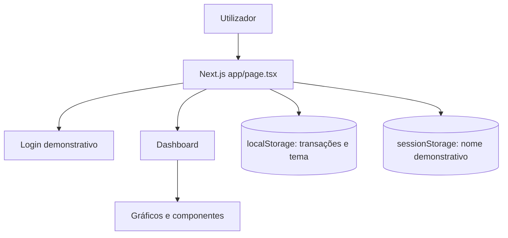
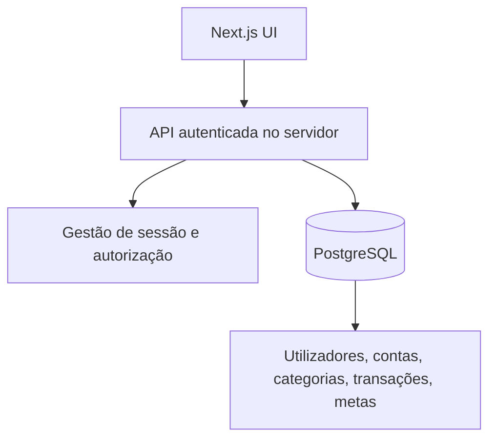

# Arquitetura — WellControled

## Estado atual: demonstração exclusivamente no navegador

Esta arquitetura **não** tem servidor de autenticação, API ou banco de dados para os dados do utilizador. O formulário de login apenas altera o estado no cliente; os dados transacionais adicionados são guardados no `localStorage`. O nome demonstrativo da sessão fica no `sessionStorage`.

## Organização

- `app/page.tsx` contém o estado principal da demo.
- `components/` reúne os elementos visuais.
- `lib/data.ts` define o tipo `Transaction`, dados fictícios e formatação.
- `app/globals.css` define estilos, layout responsivo e temas.

## Arquitetura pretendida (não implementada)

### Modelo inicial candidato

- `users`: id, nome, e-mail único, hash de password (ou referência do fornecedor de autenticação).
- `accounts`: id, user_id, nome, moeda.
- `categories`: id, user_id, nome, tipo.
- `transactions`: id, account_id, category_id, data, tipo, valor, descrição.
- `goals`: id, user_id, descrição, valor_alvo, data_limite.

Os tipos, constraints e relacionamentos definitivos serão definidos durante a modelação. Valores monetários exigem precisão decimal apropriada; permissões devem ser verificadas no servidor em cada pedido.

## Riscos conhecidos

- Login sem autenticação: não utilizar com contas reais.
- `localStorage`: dados podem ser apagados, alterados ou vistos por quem tenha acesso ao navegador.
- Gráfico de evolução: valores ilustrativos, não extraídos de base de dados.
- Ausência de testes automatizados e observabilidade nesta versão.

## Implementação v0.2 (pendente de ligação ao projeto Supabase)

- `lib/supabase/client.ts`: browser client com chave publishable.
- `lib/supabase/server.ts`: server client com cookies.
- `lib/supabase/proxy.ts` e `proxy.ts`: renovação de sessão com `getClaims`.
- `app/page.tsx`: fluxo auth e operações com transações, protegidas no banco por RLS.
- `supabase/migrations/20261107120000_initial_schema.sql`: tabela e políticas.
- `components/Toast.tsx`: notificações transitórias em 5 s.

O frontend não implementa autorização por si só: o isolamento entre contas tem de ser validado com RLS no PostgreSQL. O gráfico de evolução histórica ainda é ilustrativo.
